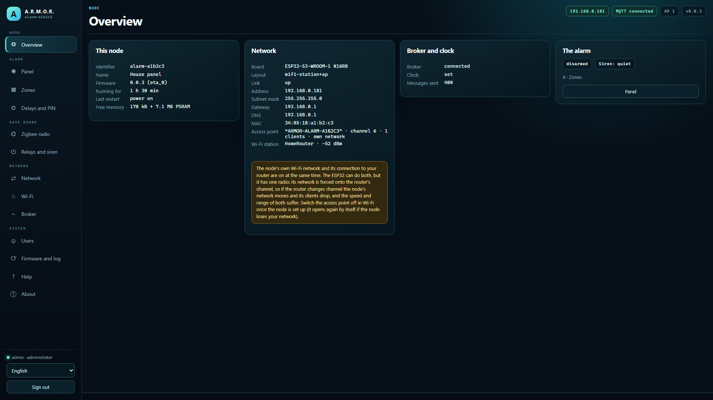
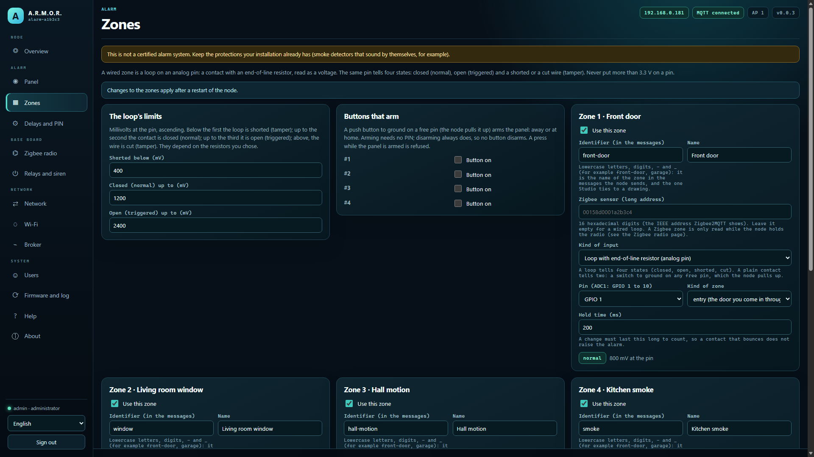
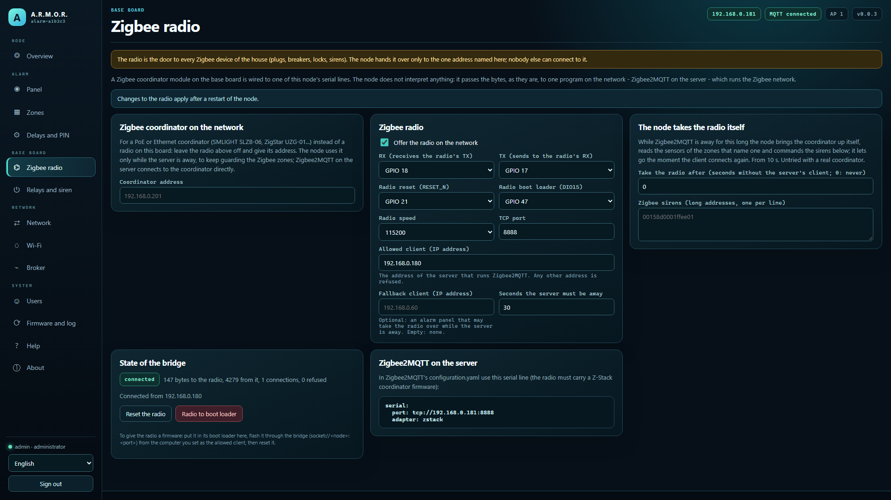
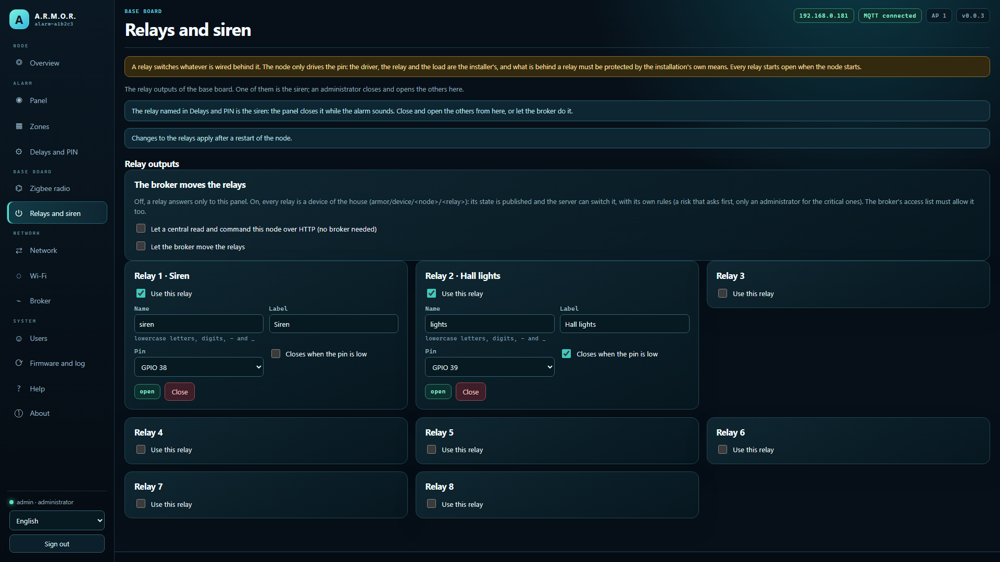

<p align="center">
  
</p>

# 🚨 ARMOR-ALARM

<p align="center">
  🇺🇸 <b>English</b> |
  <a href="README_spa.md">🇪🇸 Español</a> |
  <a href="README_fra.md">🇫🇷 Français</a> |
  <a href="README_ita.md">🇮🇹 Italiano</a> |
  <a href="README_deu.md">🇩🇪 Deutsch</a> |
  <a href="README_zho.md">🇨🇳 简体中文</a> |
  <a href="README_jpn.md">🇯🇵 日本語</a> |
  <a href="README_por.md">🇵🇹 Português</a>
</p>

### Alarm node and panel: the zones, the arming, the delays, the siren and the PIN of the house's alarm, with the firmware of the node and the rules tested on a computer (nothing has run on a board)

<p align="center">
  
  
  
  
  
  
</p>

---

**Honesty check - what runs today:** What exists is the **core of the alarm** (what a zone is, how a wired loop read by the ADC becomes a state, the panel's rules: arming, delays, the alarm, the siren, the PIN with lockout) and the **firmware of the node** built on it (settings, web panel, messages with the server, the Zigbee radio's bridge, a Zigbee coordinator on the network, relays, Bluetooth, signed updates), which builds for both boards; the core, the settings, the messages and the panel in a real browser against a stand-in node are tested on a computer with 477,665 checks in 6 test programs. **Nothing has run on a board or on a real installation, no zone has been wired and no siren connected, the node's own Zigbee conversation with a coordinator (local or on the network) is written and tested against a stand-in coordinator but has never run against a real coordinator or a real sensor, and this is not a certified alarm system.**

---

## 📋 At a glance

| | |
|---|---|
| Version | `0.3.5` |
| Maturity | Functional |
| Tests | 477,665 checks in 6 programs (`ctest`) |
| Stack | C++17 host-tested core; ESP-IDF 5.4 firmware for the ESP32-S3 (PoE Ethernet and Wi-Fi boards) |
| On real hardware | None yet: no board, zone, siren or Zigbee coordinator connected (host tests, the build and the panel in a browser only) |

## 🎯 Overview

* **Zones:** four kinds - *instant* (a door, a window), *entry* (the door you come in through: it starts the entry delay), *interior* (motion: only in "away") and *always* (smoke, gas, panic: armed or not). A zone may be a wired loop or a Zigbee sensor.
* **The wired loop:** a contact with an end-of-line resistor, read as a voltage, gives four states in one pin - normal, triggered, and tamper for a shorted or a cut wire. The limits are settings; a debouncer keeps a bouncing contact from raising the alarm.
* **The panel:** *away* and *stay* arming, an exit delay that does not treat the person leaving as an intruder, an entry delay, an alarm that **latches** until a correct disarm, a siren that stops by itself after a time, bypass of open zones when forced (never a sounding smoke detector), and a log of the last hundred events.
* **The PIN:** arming needs none, disarming and silencing do; wrong PINs are counted and, after a few, everything is refused for a while, even the right PIN.
* **Silence without disarming:** while the siren sounds, a correct PIN stops it at once with the system still armed - the alarm stays latched and recorded, a zone that has not sounded yet may sound it again, and a wrong PIN counts toward the lockout like a wrong disarm PIN.
* **The plan:** a gateway on the electrical node's board (a Zigbee radio, wired zones, a siren relay) that works with ARMOR-SERVER and **keeps guarding when the server is away**: a panel takes the radio over from the server through the Zigbee bridge of ARMOR-ELECTRICAL. See [the design](docs/DESIGN.md) and [the failover](docs/FAILOVER.md).
* **The node:** firmware for the ESP32-S3 (PoE Ethernet or Wi-Fi) with up to eight wired zones, the siren on a relay, the web panel of every node in eight languages, the Zigbee radio lent to Zigbee2MQTT, and the messages `armor/alarm/<node>/state|command|result`; the server may arm and disarm only when three independent switches allow it. See [the firmware](docs/NODE_FIRMWARE.md), [the messages](docs/ALARM_MESSAGES.md) and [the hardware](docs/HARDWARE.md).
* **Taking the radio over:** after the server's Zigbee2MQTT has been away for a set time the node brings the coordinator up itself (ZNP), reads the sensors of the zones that name one (IAS Zone) and commands Zigbee sirens (IAS WD), and lets go the moment the client returns. **Not yet:** a real coordinator or sensor, the hardware and any test on a real installation.
* **A restart does not disarm the house:** the mode, a running alarm and the zones left out are kept in flash and taken back at start; a cut or shorted loop is never left out; messages go through a queue (no deadlock with the broker) and the watchdog restarts the board if the task that reads the zones stops.
* **Signed over-the-air updates:** the node installs from GitHub only an image whose SHA-256 matches and that carries a valid Ed25519 signature of the maintainer (the public key is in the firmware, the private one never leaves the maintainer); a file uploaded by hand by an administrator in the panel is still accepted. The pages and messages of the panel are in eight languages.
* **Bluetooth pairing with a PIN:** the six-digit PIN is derived from the set-up code, printed on the USB console and shown to an administrator in the panel; the phone has to enter it before it may write the node's settings.
* **Siren and restarts:** the siren's relay belongs to the alarm alone (the broker, the central and the panel cannot move it, and it does not fall back to open when the broker is lost); a zone that has not sounded yet sounds the siren again after it timed out; an alarm of smoke or panic with the system disarmed, a silenced alarm and a lockout come back after a restart; a reset by hand is refused while the alarm is armed; a Zigbee sensor that never speaks counts as lost.
* **Only the house may use the panel:** the panel answers the private network by default (or the networks its owner lists, such as a VPN), refuses a list that would lock out whoever saves it, counts wrong passwords for each person as well as each address, and works behind the server's proxy so that it can be reached from outside the house without publishing the node.**A zone that cannot be read is not shown as closed:** if the converter does not start or a loop gives no reading for five rounds in a row, the zone is in *trouble* - it is not guarding, it never sounds the siren, it stops an arming (unless forced, and then it is left out and noted) and the server warns.
* **Optional encrypted link to the broker (TLS):** off by default, so the node talks plain MQTT as before. A switch and a box for the certificate of the installation's own authority (PEM, at most 2 KB) in the Broker page make it connect with `mqtts://`, trust that authority only and check that the broker's certificate was made for the address it reached; anything that is not one PEM certificate is refused. Covered by host tests; the handshake has not been run on a board yet.

## 🖼️ Screenshots

Captured at 1920×1080 on a test bench, with sample data and no real installation behind them.

<table>
<tr><td width="50%" valign="top"><br><sub>Overview: the state of the node at a glance - network, broker, firmware and what it reports.</sub></td><td width="50%" valign="top"><br><sub>Zones: each wired or Zigbee zone of the panel, its kind, hold time and live state.</sub></td></tr>
<tr><td width="50%" valign="top"><br><sub>Zigbee radio: the serial bridge to the coordinator module, which client may use it, and the state of the bridge.</sub></td><td width="50%" valign="top"><br><sub>Relays and siren: the outputs of the base board and what drives each one.</sub></td></tr>
</table>

## 🧩 Role in A.R.M.O.R.

ARMOR-ALARM is the alarm panel: the zones, the arming, the delays, the siren and the PIN are decided on the node itself, so the house is still guarded when the server is away. [ARMOR-SERVER](https://github.com/JuanenRac/ARMOR-SERVER) shows it, ties Zigbee sensors to its zones and, when you allow it, arms and disarms it; the *Alarm panels* menu and the *Alarm Designer* of [ARMOR-STUDIO](https://github.com/JuanenRac/ARMOR-STUDIO) and the [ARMOR-ANDROID-CONTROL](https://github.com/JuanenRac/ARMOR-ANDROID-CONTROL) app drive it. Its Zigbee radio can be on the board or a coordinator on the network.

## 📂 Repository Structure

```text
ARMOR-ALARM/
├── core/    alarm_zone, alarm_panel (the rules), alarm_config, alarm_message, alarm_runner (the node), plus the settings every node shares
├── main/    the ESP-IDF firmware: alarm_manager, the web server, the Zigbee bridge, the relays
├── panel/   the web panel (eight languages)
├── tests/   test_alarm (the rules), test_node (settings, messages, runner), test_mqtt_tls (the optional encrypted link to the broker), test_release (update from GitHub), emit_samples + check_samples (the messages against the contract), test_zigbee (ZNP, IAS Zone and WD, the node's own conversation with a coordinator)
├── tools/   the stand-in node and the browser test of the panel
├── docs/    DESIGN, FAILOVER, SAFETY, NODE_FIRMWARE, ALARM_MESSAGES, HARDWARE, BASE_BOARD, ZIGBEE, BLE_PROVISIONING
└── images/  brand assets
```

## 🛠️ Development Environment

**Requirements:** a C++17 compiler for the host tests, the ESP-IDF 5.4 container to build the image, an ESP32-S3 board (PoE Ethernet or Wi-Fi)

```bash
cmake -S tests -B build/host && cmake --build build/host && ctest --test-dir build/host   # 477,665 checks: the rules, the settings, the messages, the runner and the update from GitHub
```

See the [design](docs/DESIGN.md), [how the panel takes over from the server](docs/FAILOVER.md) and the [safety notes](docs/SAFETY.md).

## 🔗 Related Projects

**A.R.M.O.R.** (Autonomous Radar & Multimodal Observation Range) is a perimeter-security system made of independent repositories. Each one has its own version, its own tests and its own README; this is the family:

* **[ARMOR-COMMON](https://github.com/JuanenRac/ARMOR-COMMON)** - Message contracts, validators, conformance vectors and generated types
* **[ARMOR-RADAR](https://github.com/JuanenRac/ARMOR-RADAR)** - Field-node firmware for ESP32-S3 with three radars and its own web panel
* **[ARMOR-SOLAR](https://github.com/JuanenRac/ARMOR-SOLAR)** - Solar inverter and battery protocols and the messages of a gateway node
* **[ARMOR-ELECTRICAL](https://github.com/JuanenRac/ARMOR-ELECTRICAL)** - Electrical node: meters, the message of the network's readings and the rules for switching
* **ARMOR-ALARM** (this repository) - Alarm node and panel: zones, arming, delays, siren and PIN, with the server or without it
* **[ARMOR-HMI](https://github.com/JuanenRac/ARMOR-HMI)** - Touch panel: the state of the system on a wall screen, arming and acknowledging, and the home of the voice assistant
* **[ARMOR-NETWORK](https://github.com/JuanenRac/ARMOR-NETWORK)** - The local network: its devices, the internet and what changes
* **[ARMOR-SERVER](https://github.com/JuanenRac/ARMOR-SERVER)** - Central coordinator: telemetry, alarms, devices, solar readings and cameras
* **[ARMOR-STUDIO](https://github.com/JuanenRac/ARMOR-STUDIO)** - Web console: cameras, radar, alarms, solar energy and the 2D/3D site designer
* **[ARMOR-ANDROID-CONTROL](https://github.com/JuanenRac/ARMOR-ANDROID-CONTROL)** - Android operator client with a live 2D/3D radar
* **[ARMOR-SERVER-AI](https://github.com/JuanenRac/ARMOR-SERVER-AI)** - Visual inference policy that explains its decisions and never actuates
* **[ARMOR-VISION](https://github.com/JuanenRac/ARMOR-VISION)** - Camera zones, masks and detection rules for the Jetson Orin NX
* **[ARMOR-VOICE-AI](https://github.com/JuanenRac/ARMOR-VOICE-AI)** - Offline voice intents with a confirmation that cannot be forged
* **[ARMOR-HARDWARE](https://github.com/JuanenRac/ARMOR-HARDWARE)** - Enclosures, electronics and the bench acceptance matrix
* **[ARMOR-DEVOPS](https://github.com/JuanenRac/ARMOR-DEVOPS)** - Deployment, the CM5 test bench, backup and TLS
* **[ARMOR-SIMULATOR](https://github.com/JuanenRac/ARMOR-SIMULATOR)** - Offline telemetry simulator with repeatable faults
* **[ARMOR-UPDATER](https://github.com/JuanenRac/ARMOR-UPDATER)** - Detects, installs and updates the ecosystem's own repositories
* **[ARMOR-DOCS](https://github.com/JuanenRac/ARMOR-DOCS)** - Architecture, security baseline and the capability matrix

## 📚 Documentation & Community

Where to read more:

* [Capability matrix: what is proven and what is not](https://github.com/JuanenRac/ARMOR-DOCS/blob/main/docs/CAPABILITY_MATRIX.md)
* [Project catalogue: versions and how the repositories depend on each other](https://github.com/JuanenRac/ARMOR-DOCS/blob/main/docs/PROJECT_CATALOG.md)
* [Changelog of this repository](CHANGELOG.md)
* [License (GPL-3.0-or-later)](LICENSE)
* Questions, ideas and reports: electrohobby3d@gmail.com

## 👤 AUTHOR

**JuanenRac (Electro Hobby 3D)** · electrohobby3d@gmail.com

## 📜 LICENSE

GPL-3.0-or-later - see [LICENSE](LICENSE).
